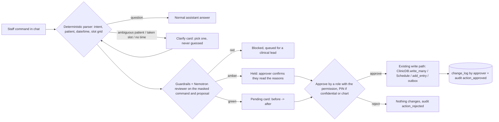

# Notes, known limits and roadmap (V3)

What works today, what doesn't yet, and what would close each gap. Ordered by impact on the demo.

## Known limits

### 1. Leash's own Nemotron calls go to the NVIDIA cloud
Clinic Assistant's reviewer runs Nemotron **locally** (`nemotron-mini` via Ollama). Leash's gateway
detectors and reasoner (`leash/nemotron.py`) call `integrate.api.nvidia.com` and, for NemoGuard,
`ai.api.nvidia.com` when `NVIDIA_API_KEY` is set (otherwise they replay recordings or fall back locally).
That traffic carries synthetic data and is allowed by the team rule, but it is the one path that leaves
the machine, and Clinic Assistant's Network view cannot see it (it lives in another process).

**To close it:** point Leash at a local OpenAI-compatible endpoint. `leash/nemotron.py` already accepts a
loopback base URL: `LEASH_NEMOTRON_BASE_URL=http://127.0.0.1:11434/v1` plus per-role model overrides
(`LEASH_NEMOTRON_LIGHTNING_MODEL`, `LEASH_NEMOTRON_SAFETY_MODEL`, `LEASH_NEMOTRON_JAILBREAK_MODEL`, e.g.
`nemotron-mini`), and `LEASH_NEMOGUARD=off` or a loopback `LEASH_NEMOGUARD_URL`. This is a Leash-side
change for the Leash build to make and measure; nothing in `clinic-assistant/` changes.
Design: https://claude.ai/artifact/Xwta3gMSPoC3bSB2x3gRyw

### 2. The reviewer is only tested with the stand-in
All reviewer tests use the stand-in (`MOCK_LLM=1` / `REVIEWER_MOCK=1`). Before the demo: `ollama pull
nemotron-mini`, run `python3 live_check.py`, and check that answers are not held by timeouts on the
demo machine (`reviewer.timeout_s` is 20 s; an Intel Mac CPU may need more).

### 3. Live updates only through the app
Patients, chart entries and appointments update in real time, each with a `change_log` row, but only
through the UI or its signed-in API. There is no bulk import (CSV/FHIR) and no way for another program
to write without a user session.
**To close it:** a `scripts/import_patients.py` that validates each row with `records.validate_patient`
and writes through `ClinicDB.write_many` as a named system user, so every import is in `change_log`.

### 4. The network audit covers this app only
The Network view reads this app's own `model_call` audit entries and checks its configured addresses.
It does not see other processes (Leash, Ollama's own update checks, the browser) or packets.
**To close it:** an OS-level egress check on the demo machine (macOS: `lsof -i -n -P` / Little Snitch;
Windows: `Get-NetTCPConnection`), or a firewall rule that blocks outbound traffic for Ollama and Python,
then show that the app still works.

### 5. Leash integration limits (from the N23 build)
One role policy for every Clinic Assistant role (`scheduling_assistant`); no behaviour model for a human
front end, so patient searches are often held; approving a held call in the Leash dashboard does not
return the record to Clinic Assistant.

### 6. Prototype security gaps (before any real data)
HTTP only on 127.0.0.1, no SSO/MFA, a shared demo PIN, SQLite single-writer (one app process per data
folder), no disk encryption or off-machine audit copy. See "Not done yet" in `README.md`.

## Done in 2.12

Reviewer on/off demo switch (audited, stored in `clinic.db`), three one-click attack scenarios, `docs/DEMO.md`.

## Assistant actions (v2.13)

The assistant now works like a staff agent: a command typed in **Ask a general question**, the patient chat
pane or the front-desk assistant ("Move Desmond F. from Tuesday to Wednesday 10am", "Change syn-012's phone
to 555-0199") becomes a **proposal card**, never a write. Code: `app/actions.py`, UI: `static/actions.js` +
`static/actions.css`, tests: `tests/test_actions.py`, rules: `assistant_actions` in `config/policy.json`.

What was built:
- **Reschedule** (cancel + rebook in one `write_many` transaction, both rows in `change_log` by the approver),
  **book**, **cancel** (with a listed reason) and **fill a slot** (suggests patients with no visit booked; the
  person picks). Role `book` (front desk) approves; clinicians can propose and it waits on Home for the desk.
- **Update contact details**: phone, address, preferred contact, language, insurance plan, member id. Role
  `register_patient`. Phone, address and member id need the PIN; their old value stays hidden on the card.
  Clinical words (medicines, allergies, conditions, results) are refused with a pointer to Add to chart.
- **Prepare a reminder** for an upcoming appointment (existing reminder flow; a person still sends it).
- **Handover note** (chart Addendum, `edit_chart` + PIN) and **referral letter** (outbox draft that a second
  clinician approves): clinical roles only, both to propose and to approve; the draft text can be edited before
  approval and the edited text is checked again.
- Every proposal runs the guardrail input check and the reviewer (`reviewer_pre`); red blocks it, amber holds it.
- Audit: `action_proposed`, `action_approved`, `action_rejected`, `action_blocked`, `action_failed` with ids,
  type and tier only (no command text). Proposals live in `data/proposals.json` (runtime, not committed).
- UI: proposal / clarify / error cards in the chat logs, a "What can the assistant do?" popover with
  examples for the signed-in role, and "Assistant proposals waiting" on Home.
- Endpoints: `POST /api/actions/propose`, `POST /api/actions/decide`, `GET /api/actions`, `GET /api/actions/help`.

Researched, not built yet (what real clinic assistants do):
- Waitlist table with patient preferences (days, times, clinician) and auto-offer when a slot opens.
- Recurring / series bookings (weekly INR checks, physio blocks) and multi-provider room/resource scheduling.
- No-show follow-up: list today's no-shows and draft a rebook message for each.
- Batch reminders: one approval for all of tomorrow's reminders, with per-patient contact preference.
- Lab result notifications: draft a patient-friendly "your result is normal / please call" message for clinician sign-off.
- Prescription refill requests: collect the request, check the last visit and labs, queue for a clinician.
- Prior-authorization drafts: fill the payer form from the chart for clinician review.
- Insurance eligibility check before the visit (needs a payer API, so it would leave the machine: out of scope).
- Intake forms: send a pre-visit questionnaire and file the answers as a draft note.
- Triage of inbound portal messages (route to desk, nurse or clinician; flag urgent words).
- End-of-day summary for the clinic lead (visits done, no-shows, open proposals, held answers).
- LLM rewording of proposal summaries and drafts (the parser is deterministic today; the model could polish wording).

## Roadmap

| Next | Why | Size |
| --- | --- | --- |
| Run Leash's Nemotron stages against local Ollama (limit 1) | Nothing leaves the machine, end to end | Leash-side env change + re-measure |
| Real-model reviewer check and timeout tuning (limit 2) | Demo reliability | Small |
| Assistant actions: waitlist, batch reminders, no-show follow-up (see above) | The assistant does more of the clinic's routine work, still approval-only | Medium |
| Bulk import script through `ClinicDB.write_many` (limit 3) | Load more synthetic data with full change history | Small |
| OS-level egress check in the Network view (limit 4) | Prove "nothing leaves" for every process | Medium |
| Per-role Leash policy for human users (limit 5) | Fewer false holds in integrated mode | Leash-side |
