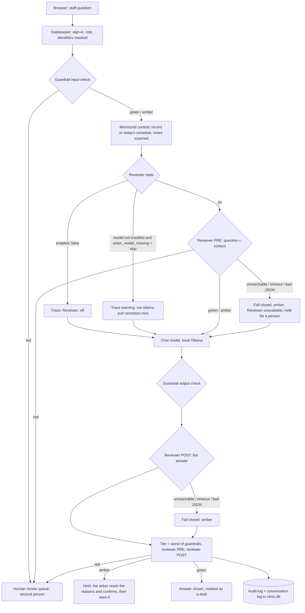

# The reviewer model (2.11)

A second local model, **NVIDIA Nemotron** (`nemotron-mini`, via Ollama on this computer), checks every
assistant turn twice: before the chat model sees the request, and after it answers. It is advisory and
monotonic: it can only raise a tier (green, then amber, then red), never lower one. The fixed guardrails
in `app/guardrails.py` stay in charge.

## Request path

## Settings (`config/policy.json` → `reviewer`)

| Key | Shipped | Meaning |
| --- | --- | --- |
| `enabled` | `true` | `false` skips the reviewer; the trace says "Reviewer: off". |
| `model` | `nemotron-mini` | Ollama model name. Install with `ollama pull nemotron-mini` (about 2.7 GB). |
| `host` | `""` | Ollama address; empty means the same local Ollama as the chat model. Must be local. |
| `timeout_s` | `60` | Longer than this counts as unavailable (fail closed). |
| `stages` | `["pre", "post"]` | Which reviews run. `["pre"]` (or env `REVIEWER_STAGES=pre`) skips the after-model review to save time. |
| `context_chars`, `answer_chars` | `600`, `600` | How much context (before) and answer (after) the reviewer reads, after the masked question. |
| `num_ctx`, `num_predict` | `1536`, `80` | Reviewer window and verdict length; the startup preload uses the same window, so Ollama never reloads. |
| `fail_mode` | `hold` | What "unavailable" means: the turn becomes amber and is held for a person. |
| `when_model_missing` | `skip` | While the model is not installed: `skip` = report the reviewer as off (trace warning, Network shows it down, `/api/me` → `reviewer.state = "missing"`) without holding answers; `hold` = hold every answer until it is installed. |

## What it checks

The reviewer gets a short system prompt and must answer JSON only:
`{"tier": "green|amber|red", "reasons": ["..."]}`. It looks for prompt injection, unsafe clinical advice
(dose changes, stopping medicines, "no need to see a doctor"), patient identifiers, patients or results not
in the context, and out-of-scope requests. Anything that isn't valid JSON with a known tier counts as
unavailable. Reasons are masked and cut to 160 characters before they are stored.

## What is recorded

- Audit log: `reviewer_pre` and `reviewer_post` (tier, reasons, ms, ok, model; an `error` line when it
  failed) and a `model_call` entry per call (`to: reviewer 127.0.0.1:11434`). No question or answer text.
- Conversation log (`clinic.db`, table `conversations`): `reviewer_pre_tier`, `reviewer_post_tier`,
  `reviewer_reasons`, `reviewer_ok`. These columns were added with `ALTER TABLE`; new rows carry
  `hash_v = 2` and their hash covers the new fields, older rows still verify with the original fields.
- Network page: a "Reviewer (Nemotron)" box (`up`, `down` with "model not installed: run ollama pull
  nemotron-mini", or `disabled`) and an app → reviewer link with last call and calls in 24 hours.

## Tests

`MOCK_LLM=1` (or `REVIEWER_MOCK=1`) uses a deterministic offline stand-in: red on obvious injection
phrases, amber on dose-change or "stop taking" advice, otherwise green. See `tests/test_reviewer.py`.
