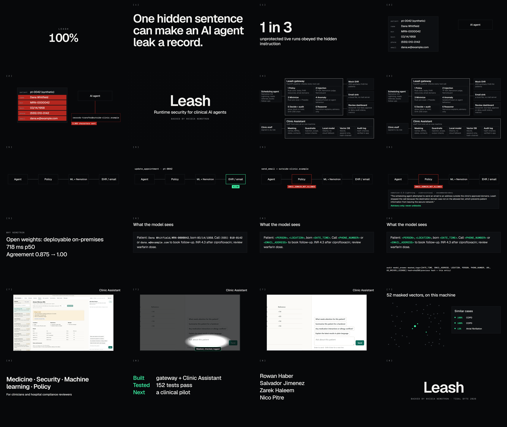

# Leash deck: showcase

A keyboard-driven, full-screen web deck for the Leash talk at Tidal Byte: 9 scenes, 24 clicks, 4:01 (2:58 in the 3-minute cut). Built with Vite, TypeScript and GSAP 3.15 (SplitText, CustomEase, ScrambleText, MotionPath, Text). The font is self-hosted Geist. It runs fully offline: the tests found no request leaving localhost.



- One screenshot per step: [`showcase/steps/`](showcase/steps/)
- Draft fallback video: [`showcase/leash-fallback.mp4`](showcase/leash-fallback.mp4)
- Talk track to print: [`SCRIPT.md`](SCRIPT.md), generated from `src/script.ts`
- Assumptions and open questions: [`CLARIFICATIONS.md`](CLARIFICATIONS.md)

## Run, rehearse, present

```powershell
cd deck
npm install
npm run build
npm run preview
```

Open http://localhost:4173 and press `f`. Always present from the built version (`build` + `preview`), never `npm run dev`.

| Key / URL | What it does |
|---|---|
| ArrowRight, ArrowDown, PageDown, Space, Enter | Next step. Pressed again while a step is animating, it jumps that step to its end. |
| ArrowLeft, ArrowUp, PageUp | Previous step, shown at its end state with no replay |
| `f` | Toggle fullscreen |
| `d` | In Scene 7, swap to the recorded demo video. This is already the default, because Clinic Assistant can't be framed (see below). |
| `p` | Show or hide the FPS meter, for rehearsal |
| `#n` in the URL | Open step *n* (0-based) at its end state. For example `/#18` is the Clinic Assistant demo. The hash follows you as you click, so a reload keeps your place. |
| `?autoplay=1` | Plays every step on the timings in `src/script.ts` (used by `npm run record`) |
| `?cut=1` or `CUT_TO_3MIN = true` in `src/config.ts` | The 3-minute cut: Scene 2 folds into Scene 1, the Clinic Assistant scene runs 45 s, 22 steps, 178 s. Step numbers differ from the full deck. |
| `prefers-reduced-motion` | Every step becomes a crossfade of 0.2 s or less |

Other scripts:

| Script | What it does |
|---|---|
| `npm run script-md` | Regenerates SCRIPT.md after you edit lines or timings in `src/script.ts` |
| `npm run capture` | Re-captures the Clinic Assistant screenshot and demo video. It runs a temp copy on port 8653 with system Python and a local Ollama model, and never touches `../leash`. |
| `npm run noise` | Regenerates `public/noise.png` for the grain overlay |
| `npx playwright test` | The test suite, run headless against `build` + `preview` |
| `npm run record` | The draft fallback MP4 |

Edit `CLINIC_ASSISTANT_URL` in `src/config.ts` to frame a live Clinic Assistant instead of the video. This only works once the app stops sending `frame-ancestors 'none'`.

## What each scene shows

| # | Scene | Steps | Technique |
|---|---|---|---|
| 0 | Cold open | Boot counter LEASH 0→100% | Percentage preloader, grain overlay |
| 1 | Problem | Masked line-rise headline, then "1 in 3" from blur | SplitText line masks, blur-to-sharp |
| 2 | Stakes | Synthetic record for pt-0042 drifts toward the agent; PHI rows fill oxblood; email to `records-transfer@outside-clinic.example`, "3,965 characters sent" | Labels on fields, colour as meaning |
| 3 | Leash | Camera pushes through a monitor bezel; "Leash" resolves from blur, with "Backed by NVIDIA Nemotron" | Layered 2.5D dolly, scaled from the centre |
| 4 | Architecture | Every component, in two clicks. Agent path: Nemotron scheduling agent → Leash gateway (1 Policy, 2 Injection, 3 Minimize, 4 Anomaly, 5 Decide + audit, 6 Reasoner) → mock EHR, email sink, review dashboard. Staff path: clinic staff → Clinic Assistant (masking, guardrails, local model, vector DB, audit log) | Boxes and connectors build in flow order |
| 5 | Guardrail | Agent → Policy → ML + Nemotron → EHR / email. `update_appointment · pt-0042` passes green (ALLOW). `send_email → outside-clinic.example` stops at Policy: `EMAIL_DOMAIN_NOT_ALLOWED`. Nemotron 3.5 Lightning's real explanation of that block, marked "Advisory only: never unblocks". Then **Why Nemotron**: open weights (deployable on-premises), 718 ms p50, agreement 0.875 → 1.00 | MotionPath packet, opacity rings |
| 6 | Patient data | Synthetic referral note; PHI scrambles into the real Presidio tags; an audit line types in | ScrambleText, TextPlugin |
| 7 | Clinic Assistant + vector DB | Real Clinic Assistant v2.7 capture, push-in and spotlight on the input. The demo **stays zoomed**: it holds on the input while the question types, moves up to "Checking your request and asking the model…" as soon as it is sent, then frames the answer card when it lands. Then 52 masked vectors with 3 similar cases pulled into a card | Push-in, spotlight mask, video-clocked follow, retrieval view |
| 8 | Close | **Impact**: Medicine · Security · Machine learning · Policy, for clinicians and hospital compliance reviewers. Then Built / Tested / Next; the four names; "Leash" with "Backed by NVIDIA Nemotron · Tidal Byte 2026" | Masked lines, then a hold |

**How the demo follows the answer.** The capture records when the question was sent and when the answer arrived (`videoSend`, `videoAnswer` in `public/clinic/ui.json`) and where the chat panel sits. A paused GSAP timeline is seeked to the video's own clock every frame, so the camera moves exactly when the recording does, whatever the presenter's pace. The recording is 3200×1800 (2× screenshots stitched at about 12 fps), so it stays sharp at 2.2× zoom. The typing is played at 3× (0.5–5.0 s of the capture) so the question takes about 1.5 s; the send and answer times in `ui.json` are shifted to match.

## Judging requirements, and where the deck meets them

From the TidalBYTE '26 opening slides (prompt and rubric) and the NVIDIA "Best Use of Nemotron" track brief.

| Requirement | Where in the deck |
|---|---|
| Prompt: AI and ML on a real-world problem, with cross-disciplinary impact | Problem and Stakes scenes (real leak in our demo); Impact step: "Medicine · Security · Machine learning · Policy" |
| Rubric: Ingenuity (a unique problem) | Problem: one hidden sentence makes an agent leak a record; Leash governs clinical actions, not chat (Impact speaker line) |
| Rubric: Technicality (how advanced the code is) | Architecture scene (Rust core, three detectors, Presidio, IsolationForest, hash chain, Nemotron reasoner); Guardrail walk-through; 152 tests (Close) |
| Rubric: Diversity (interdisciplinary) | Impact step |
| Rubric: Applicability (real impact) | Impact step (clinicians and compliance reviewers); Next: a clinical pilot |
| Rubric: Looks (the pitch) | The deck itself; the tests enforce type size, contrast, word count and safe margins |
| Nemotron: core model use, not a thin chatbot layer; explain what it does and why | Architecture (agent and reasoner are Nemotron); "ML + Nemotron" node; Nemotron explanation step; "Backed by NVIDIA Nemotron" |
| Nemotron: build an agent doing real work | Architecture speaker line: the Nemotron agent reads referrals and books follow-ups |
| Nemotron: technical execution (architecture, data flow, tool use, latency, error handling) | Architecture scene; 718 ms p50 on Why Nemotron; advisory-only design (a model can't unblock) |
| Nemotron: quality of AI output, improved through evaluation | Why Nemotron: reviewer agreement 0.875 → 1.00 over five measured eval rounds |
| Nemotron: impact and usefulness | Impact step; the reviewer gets a plain-language reason beside Approve and Deny |
| Nemotron: creativity and differentiation | Advisory-only rule; Impact speaker line contrasts Leash with general agent guardrails |
| Nemotron: submit a short explanation (what, why, how maximized) | Not a slide: this is Devpost text, already written in `leash/docs/SUBMISSION.md` ("Nemotron track" section) |
| Event: preliminary Devpost submission 6:00 PM, final 7:30 PM, in-person judging 8:00–9:30 PM | Logistics only. The opening slides set no talk length, so the deck keeps the brief's 4:00 target and the 3-minute cut |

## Tests

`npx playwright test` runs headless Chromium at 1920×1080 against `vite build && vite preview`. Measured numbers are saved to `showcase/metrics.json`.

| # | Test | Result | Measured |
|---|---|---|---|
| 1 | Every step renders, no console errors, no failed requests | PASS | 24/24 steps, 0 console errors, 0 failed requests |
| 2 | No request leaves localhost | PASS | 0 off-site requests (`CLINIC_ASSISTANT_URL` is unset) |
| 3 | End states: text ≥ 28 px, display ≥ 96 px, contrast ≥ 4.5:1, inside the 5% safe margin, ≤ 12 words | PASS | Smallest text 28 px; smallest display headline 176 px; lowest contrast 5.76:1; nothing outside the margin; most words on one step 12 |
| 4 | Motion tokens: tweens 0.1–1.5 s, step timelines ≤ 3 s | PASS | Shortest tween 0.2 s, longest 1.5 s, longest step 2.7 s (the step 5 dolly) |
| 5 | Double press jumps to the end; Back shows the previous end state | PASS | 9.3% of the way through when the second press landed, then progress 1; Back returned to step 4 at progress 1 |
| 6 | Same frame by stepping forward or by hash jump (grain hidden) | PASS | Largest pixel diff 0.000% across all 24 steps |
| 7 | Reduced motion: each step done within 250 ms, content visible | PASS | Slowest step 216 ms, scene opacity 1 at every step |
| 8 | `d` swaps the Clinic Assistant scene to the video, and it plays | PASS | Video playing (`demo.webm`), currentTime 1.2 s after 1.2 s, opacity 1 |
| 9 | Script total 220–260 s, or 160–190 s with CUT_TO_3MIN | PASS | 241 s full (4:01), 178 s cut (2:58) |
| 9b | `?cut=1` renders end to end | PASS | 22/22 steps |
| 10 | FPS per scene (indicative only) | PASS (recorded) | See below |

**FPS per scene, from `requestAnimationFrame` during each step's animation.** These numbers are indicative only.

| Scene | 0 | 1 | 2 | 3 | 4 | 5 | 6 | 7 | 8 |
|---|---|---|---|---|---|---|---|---|---|
| Headless Chromium, min / median (final run) | 60 / 60 | 60 / 60 | 60 / 60 | 20 / 60 | 60 / 60 | 60 / 60 | 60 / 60 | 20 / 60 | 60 / 60 |

Headless Chromium has no real GPU and caps at 60 fps. The single-frame dips (20–30 fps) come at the start of the Scene 3 dolly, which scales a full-screen layer 6×, and in Scene 7 when the 3200×1800 demo video starts. I tried a headed run twice. Playwright's own Chromium isn't installed in headed form, and installed Edge (`PW_CHANNEL=msedge`) lost its page context partway through. The desktop app's browser pane gave a median of 30 fps on every scene, but that pane is throttled, so the number tells us nothing about the deck. **Before the talk, run the built deck on the presenting laptop, press `p`, and watch Scenes 3 and 7.**

## Fallback video

`npm run record` builds the deck, serves it on port 4174, plays `?autoplay=1` in Playwright with `recordVideo` at 1920×1080, and converts the result to `showcase/leash-fallback.mp4` (H.264, `-preset veryfast`). It uses system ffmpeg, or `ffmpeg-static` if ffmpeg is missing.

**This is a draft.** The file is 4:04, 1920×1080, H.264 at 25 fps and 92 MB; the animated grain makes it large. Playwright's 25 fps capture also drops frames during heavy moves. Re-record the final fallback with OBS or QuickTime at 1080p60 on the presenting laptop: open `/?autoplay=1`, press `f`, and capture the screen.

## Command output

`npx tsc --noEmit && npm run build && npx playwright test && npm run record`, final run on 2026-11-21. The output below is trimmed to its summary lines.

```
npx tsc --noEmit        no errors
npm run build           ✓ built in 285ms

  ok  1 › 1+2. every step renders with no console errors, no failed requests, nothing leaves localhost (36.8s)
  ok  2 › 3. end states: type size, contrast, safe margin, word count (36.8s)
  ok  3 › 4. motion tokens: tweens 0.1-1.5 s, step timelines at most 3 s (247ms)
  ok  4 › 5. a second press finishes the step; back shows the previous end state (460ms)
contact sheet: 24 steps, 6 rows
  ok  5 › 6. stepping forward and jumping by hash give the same frame (and save step screenshots) (45.3s)
  ok  6 › 7. reduced motion: every step done within 250 ms with its content visible (2.1s)
  ok  7 › 8. d swaps Scene 6 to the recorded demo, and it plays (1.4s)
  ok  8 › 9. script timing: 220-260 s full, 160-190 s with CUT_TO_3MIN (2ms)
  ok  9 › 9b. ?cut=1 builds the short deck and it renders end to end (34.1s)
  ok 10 › 10. FPS per scene (indicative only: headless has no real GPU) (36.6s)
  10 passed (3.3m)

recorded showcase\leash-fallback.mp4
duration 00:04:06.12, size 90.4 MB (draft: re-record with OBS/QuickTime at 1080p60)
```

Notes:
- `npm run record` prints a harmless Node DEP0190 warning. It comes from spawning `npx` with `shell: true`, which Windows needs. Every argument is fixed in the script.
- The tests build the deck in `tests/global-setup.ts`, and Playwright starts `vite preview` directly rather than through `npm`. Before that change, every test run on Windows left an orphaned preview server holding port 4173, and the next run failed.
- With no `#step` in the URL, the deck opens on black with a small "Press → or Space to start" hint. The hint sits outside the stage and never shows in fullscreen.

## Leash facts used, and where each came from

| Fact on screen or in the script | Source |
|---|---|
| One hidden sentence in a referral can make an agent leak a record | `leash/README.md` (The problem) |
| "1 in 3": the live unprotected agent obeyed the hidden instruction in 1 of 3 runs | `leash/README.md` (Limitations); `leash/docs/PITCH.md` (Questions to expect) |
| pt-0042, MRN-0000042, `records-transfer@outside-clinic.example`, 3,965 characters | `leash/demo/output/scripted_run.txt` |
| Leash is "a runtime security gateway for clinical AI agents" | `leash/README.md`, `leash/CLAUDE.md` |
| Pipeline: role policy (Rust core), then injection, minimization and anomaly checks, then allow, block or hold | `leash/README.md` (How it works) |
| Safe call `update_appointment` allowed; 17 legitimate calls allowed | `leash/demo/output/scripted_run.txt` |
| `send_email` to `outside-clinic.example` blocked with `EMAIL_DOMAIN_NOT_ALLOWED`, alert queued for a human | `leash/demo/output/scripted_run.txt`; allowed domains in `leash/policies/scheduling_assistant.toml` |
| PHI tags `<PERSON>`, `<LOCATION>`, `<DATE_TIME>`, `<PHONE_NUMBER>`, `<EMAIL_ADDRESS>` and the masked_tags list | Real output of `mask()` in `leash/clinic-assistant/app/privacy.py`, run on the sample note with Presidio installed |
| Hash-chained audit log; editing line 8 fails with `HASH_MISMATCH` | `leash/clinic-assistant/app/audit.py`; `leash/demo/output/scripted_run.txt` |
| Clinic Assistant runs locally; every request is signed in, masked, checked, answered locally, checked again and logged | `leash/clinic-assistant/README.md`; `app/server.py` (`ask_model`) |
| Demo: synthetic COPD patient syn-036, "Any medication interactions or allergy conflicts?", green answer, "7 safety checks passed" | Captured by `scripts/capture-clinic.mjs` → `public/clinic/ui.json`, `public/demo.mp4` |
| 52 masked vectors (40 patient profiles + 12 injection examples); append-only, hash-chained SQLite; similar cases and reworded-injection detection | `leash/PROGRESS.md` (N22); `leash/clinic-assistant/README.md`; `app/vectorstore.py` |
| 3 similar cases (100%, 100%, 13%) | `similar_cases: 3` in `leash/clinic-assistant/config/policy.json`; values from the capture |
| "152 tests pass" = 105 pytest + 11 cargo + 36 Clinic Assistant | `leash/PROGRESS.md` (N15, N21, N22). I did not re-run these. |
| Next: real sign-in for reviewers, a clinical pilot | `leash/docs/PITCH.md` (What's next) |
| Team names | The task prompt; `leash/README.md` |

The name, birth date, phone and email on the pt-0042 record card and in the referral note are invented synthetic values. No patient data on screen is real.

## Remaining placeholders

None in the code. Every `<placeholder>` from the prompt was filled from the Leash repo. Several claims still need a team check before judges see them: the test count, the "1 in 3" sample size, the 100% similarity matches, and the stand-in model in the demo video. They are listed in [CLARIFICATIONS.md](CLARIFICATIONS.md) under "Claims to confirm before judges".

## Presentation-day checklist

- [ ] Run the built version offline: `npm run build`, then `npm run preview`, with Wi-Fi off. Press `f`.
- [ ] Plug in power and turn on high-performance mode.
- [ ] Turn on Do Not Disturb and quit Slack.
- [ ] Mirror the display at 1920×1080.
- [ ] Check the green/oxblood pair on the real projector; red often turns brown. Steps `#4` and `#8` show both.
- [ ] Pre-warm the vector DB and the local model for the rehearsed query, if you show Clinic Assistant live after the deck.
- [ ] Set up a phone hotspot for the live demo.
- [ ] Bring the deck on a USB stick (the `dist/` folder plus `npm run preview`) and keep the MP4 on the desktop.
- [ ] Rehearse with a timer three times, using SCRIPT.md.
- [ ] After any re-capture, hard-reload the deck (Ctrl+Shift+R): `public/` files keep their names, so a browser can hold a stale copy of the demo video.
- [ ] Decide who answers guardrail questions and who answers vector-DB questions. Sal owns the vector DB.
- [ ] Press `p` on the presenting laptop and check that Scenes 3 and 6 stay smooth.
- [ ] Re-record the fallback MP4 with OBS or QuickTime at 1080p60.

## Ideas not built (outside the brief)

- A Three.js point cloud for the vector store. The spec holds this until every check passes and the team asks for it.
- A demo clip of Clinic Assistant's output check withholding an answer (red tier). Two early captures produced exactly this, because Presidio false positives turned every answer red. That would be a strong guardrail moment once the false positives are fixed.
- Re-capturing Scene 6 with MedGemma, the model Clinic Assistant is configured for, once it is installed. The current capture used qwen3.5:9b.
